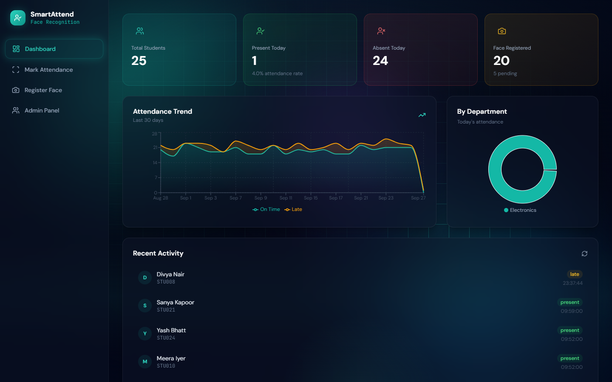
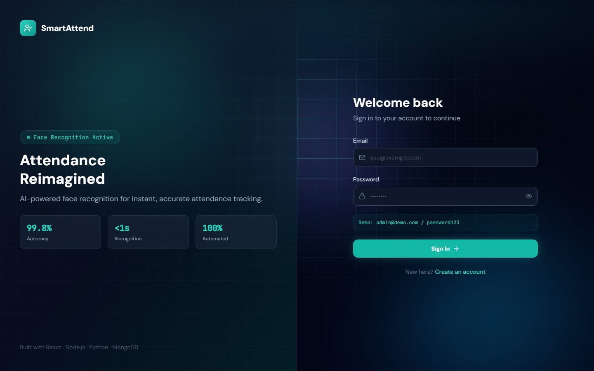

# SmartAttend — Face Recognition Attendance System

Mark attendance by looking at a webcam. SmartAttend recognizes each student's face, confirms they are a live person by asking for a blink, and records them as present or late. Admins get a live dashboard, per-department stats, CSV export and student management.

**Stack:** React · Tailwind CSS · Node.js / Express · MongoDB · Python (Flask, OpenCV, dlib `face_recognition`)



---

## Features

- **Face recognition attendance.** The webcam feed streams to a Python service that identifies registered students and marks them present, or late after 9:30 AM.
- **Liveness check (anti-spoofing).** A recognized face has to blink before attendance is marked, so holding up a printed photo or a picture on a phone doesn't work. Tilting a flat photo, which also squashes the eyes, is detected and rejected. See [How the liveness check works](#how-the-liveness-check-works).
- **Face registration in the browser.** The app captures several webcam frames, averages them into one 128-number face encoding and stores it in MongoDB.
- **Admin dashboard.** Today's present/absent counts, a 30-day trend chart (on time vs. late), a department breakdown and a recent-activity feed.
- **Attendance records.** Search and filter by date, mark students manually, and export to CSV.
- **Two roles.** Admins manage students and see everything. Students see their own attendance history and percentage.
- **Email notifications (optional).** Students get an email when their attendance is marked, sent over SMTP.
- **Polished dark UI.** An animated background, frosted-glass panels and a cursor spotlight. These respect the viewer's reduced-motion setting and pause while the camera runs.

<details>
<summary>Login screen</summary>



</details>

---

## Architecture

```
┌──────────────┐   REST (JWT)    ┌──────────────────┐      ┌─────────┐
│  React app   │ ──────────────▶ │  Node.js / Express│ ───▶ │ MongoDB │
│  :3000       │                 │  API  :5000       │      └─────────┘
└──────┬───────┘                 └────────▲─────────┘
       │ webcam frames                    │ mark attendance,
       ▼                                  │ load face encodings
┌──────────────────────────────┐          │
│  Python face service  :8000  │ ─────────┘
│  Flask · OpenCV · dlib       │
└──────────────────────────────┘
```

- **Frontend** (`frontend/`): React 18, React Router, Tailwind CSS, Recharts, `react-webcam`.
- **Backend** (`backend/`): Express REST API with JWT auth, bcrypt, Mongoose models and CSV export.
- **Face service** (`face-recognition/`): Flask API that detects and identifies faces, runs the blink check, computes encodings for registration, and calls the backend to record attendance.

```
face-recognition-attendance/
├── backend/
│   ├── config/            # Email (SMTP) helper
│   ├── middleware/        # JWT auth + role checks
│   ├── models/            # User, Student, Attendance
│   ├── routes/            # auth, students, attendance, admin
│   ├── seed.js            # Reset demo data (admin + 8 students)
│   ├── seed-dummy.js      # Add more demo students + 60 days of attendance
│   └── server.js
├── frontend/
│   └── src/
│       ├── components/    # Layout, animated background, cursor effects
│       ├── context/       # Auth + theme
│       ├── pages/         # Dashboard, Attendance, Face registration, Admin…
│       └── utils/api.js   # Axios clients for the API and the face service
├── face-recognition/
│   ├── recognize_face.py  # Flask face service (recognition + liveness)
│   ├── register_face.py   # Optional CLI: register a face from the webcam
│   └── requirements.txt
├── docs/screenshots/
└── docker-compose.yml
```

---

## Getting started

### Prerequisites

- Node.js 18+
- Python 3.9+
- MongoDB, running locally or a free [MongoDB Atlas](https://www.mongodb.com/cloud/atlas) cluster
- A webcam

### 1. Clone

```bash
git clone https://github.com/rajivBhardwaj07/face-recognition-attendance.git
cd face-recognition-attendance
```

### 2. Backend API

```bash
cd backend
npm install
cp .env.example .env     # then edit MONGODB_URI and JWT_SECRET
node seed.js             # demo admin + 8 students
node seed-dummy.js       # optional: more students + 60 days of history for the charts
npm run dev              # http://localhost:5000/api
```

### 3. Frontend

```bash
cd frontend
npm install
cp .env.example .env
npm start                # http://localhost:3000
```

### 4. Face recognition service

```bash
cd face-recognition
python -m venv .venv
# Windows: .venv\Scripts\activate    macOS/Linux: source .venv/bin/activate
cp .env.example .env
```

Then install the dependencies. **On Python 3.9–3.11** the pinned requirements work directly (you need CMake and a C++ compiler to build `dlib`):

```bash
pip install -r requirements.txt
```

**On Python 3.12+ or Windows without build tools,** use the prebuilt `dlib-bin` wheel instead:

```bash
pip install dlib-bin
pip install --no-deps face_recognition==1.3.0
pip install "setuptools<81" Click Pillow numpy opencv-python flask flask-cors requests python-dotenv \
    git+https://github.com/ageitgey/face_recognition_models
```

Start the service:

```bash
python recognize_face.py  # http://127.0.0.1:8000
```

The service signs in to the backend with the admin account set in `face-recognition/.env` and refreshes its token automatically.

### Demo logins

| Role | Email | Password |
|------|-------|----------|
| Admin | `admin@demo.com` | `password123` |
| Student | `aditya@demo.com` | `password123` |

> The demo students' face encodings are random placeholders. To try recognition with your own face, go to **Register Face** in the app, pick a student and capture your face. Then open **Mark Attendance** and press **Start Recognition**.

### Docker (alternative)

```bash
docker compose up --build
```

---

## Configuration

**`backend/.env`**

| Variable | Description |
|----------|-------------|
| `PORT` | API port (default `5000`) |
| `MONGODB_URI` | MongoDB connection string |
| `JWT_SECRET` | Secret used to sign login tokens. Use a long random string |
| `JWT_EXPIRE` | Token lifetime, e.g. `7d` |
| `FRONTEND_URL` | Allowed CORS origin |
| `SMTP_*`, `EMAIL_FROM` | Optional email notifications |

**`frontend/.env`**

| Variable | Description |
|----------|-------------|
| `REACT_APP_API_URL` | Backend API URL |
| `REACT_APP_PYTHON_API_URL` | Face service URL. Use `127.0.0.1` rather than `localhost`: the service listens on IPv4 only, and on Windows `localhost` tries IPv6 first, adding about 200 ms to every frame |

**`face-recognition/.env`**

| Variable | Default | Description |
|----------|---------|-------------|
| `BACKEND_URL` | `http://localhost:5000/api` | Backend API URL |
| `SERVICE_EMAIL` / `SERVICE_PASSWORD` | — | Admin account the service logs in with |
| `SERVICE_TOKEN` | — | Optional fixed admin JWT instead of email/password |
| `RECOGNITION_THRESHOLD` | `0.55` | Maximum face distance that counts as a match (lower = stricter) |
| `COOLDOWN_SECONDS` | `30` | Minimum gap before the same student can be marked again |
| `LIVENESS_REQUIRED` | `true` | Require a blink before marking. Set `false` to disable |

---

## How the liveness check works

Identifying a face (computing its 128-number encoding) takes about 750 ms on a CPU, far too slow to repeat on every frame while watching for a blink. So the service splits the work:

1. **Identify once.** When a new face appears, it is encoded and matched against registered students, then *tracked* from frame to frame by its position.
2. **Watch the eyes.** On every later frame the service only detects the face and its 68 landmarks, which takes milliseconds. From those it measures how open the eyes are (the *eye aspect ratio*).
3. **Detect a blink.** A blink is eye openness dropping well below that person's own normal level, then recovering. Comparing each person to their own baseline matters because natural eye openness varies a lot between people.
4. **Reject a tilted photo.** Tilting a flat photo squashes the eyes too, but it also squashes the whole face. A blink only counts if the face's overall proportions stay steady.
5. **Re-check identity.** After the blink the face is identified once more, so a photo can't be swapped for a different real face partway through.

**Limitation:** a *video* of the student blinking, replayed on a screen, can still pass. Stopping that needs depth sensing or a random challenge (for example "turn your head left").

---

## API reference

All routes are under `/api`. Authenticated routes need `Authorization: Bearer <token>`.

**Auth** (`/api/auth`)

| Method | Endpoint | Access |
|--------|----------|--------|
| POST | `/register` | Public |
| POST | `/login` | Public |
| GET | `/me` | Logged in |
| PUT | `/update-password` | Logged in |

**Students** (`/api/students`)

| Method | Endpoint | Access |
|--------|----------|--------|
| GET | `/` | Admin |
| GET | `/me` | Student |
| GET / PUT / DELETE | `/:id` | Admin |
| POST | `/:id/encode-face` | Admin: save a face encoding |
| GET | `/encodings/all` | Admin: used by the face service |

**Attendance** (`/api/attendance`)

| Method | Endpoint | Access |
|--------|----------|--------|
| GET | `/` | Admin: records, filterable by date |
| GET | `/my` | Student |
| GET | `/stats` | Admin: today, 30-day trend, departments |
| POST | `/mark` | Logged in: used by the face service and manual marking |
| GET | `/export` | Admin: CSV download |
| DELETE | `/:id` | Admin |

**Admin** (`/api/admin`)

| Method | Endpoint | Access |
|--------|----------|--------|
| GET | `/dashboard` | Admin |
| GET | `/users` | Admin |
| PUT | `/users/:id/toggle` | Admin: activate or deactivate a user |
| POST | `/students/bulk` | Admin: create students in bulk |

**Face service** (`:8000`)

| Method | Endpoint | Description |
|--------|----------|-------------|
| GET | `/status` | Health, loaded encodings, liveness setting |
| POST | `/recognize-frame` | `{ image }`: recognize faces and run the liveness check on one frame |
| POST | `/encode` | `{ images: [...] }`: return an averaged face encoding (registration) |
| POST | `/encodings/reload` | Reload encodings from the backend |

---

## Privacy note

Face encodings are biometric data. This repository contains no real face data: `.env` files, captured images and encoding files are excluded by `.gitignore`. If you deploy this for real users, get their consent, and store and delete their data in line with the privacy law that applies to you.

---

## License

[MIT](LICENSE)
